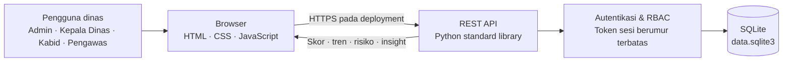
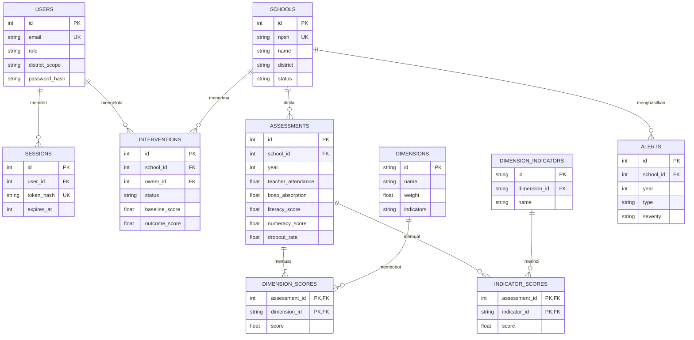
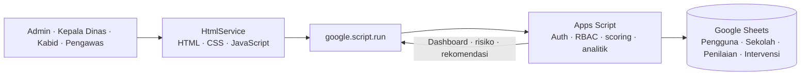
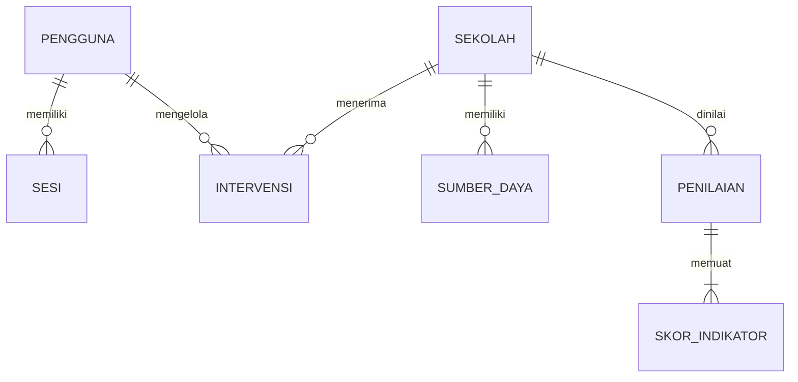

# Ruang Mutu — Monitoring Pendidikan Kabupaten Lombok Timur

Dashboard monitoring SMP Kabupaten Lombok Timur. Dashboard membaca database aktif `data/data.sqlite3`. Database tersebut memuat 307 profil sekolah dan snapshot sumber daya tahun 2026 yang cocok dengan workbook `data/Pendidikan_Lombok_Timur_Lengkap_Profil_Sekolah.xlsx`. Data penilaian yang belum tersedia tidak dibuat-buat; skor mutu, tren, dan risiko hanya muncul setelah asesmen dimasukkan.

## Templat data resmi

Unduh dan isi workbook kosong [`Template_Data_Pendidikan_Lombok_Timur_Lengkap_Profil_Sekolah.xlsx`](./Template_Data_Pendidikan_Lombok_Timur_Lengkap_Profil_Sekolah.xlsx). Sheet yang tersedia:

Saat server lokal aktif, tombol **Unduh templat data Excel** pada halaman login mengambil workbook templat kosong melalui `/download/template`. Pada dashboard, tombol **Unduh Data** menyediakan ekspor XLSX dan CSV serta tampilan cetak yang dapat disimpan sebagai PDF. Ekspor memuat profil dan metrik sekolah pada tahun yang sedang dipilih; skor penilaian tetap kosong bila belum tersedia.

1. `Petunjuk`: panduan pengisian dan catatan pemilik data.
2. `Sekolah`: satu baris per sekolah, dengan `npsn`, `name`, `district`, `status`, `address`, nama kepala sekolah, NIP kepala sekolah, dan status akreditasi. Isi NIP resmi 18 digit; biarkan kosong bila tidak tersedia.
3. `Penilaian`: satu baris per kombinasi sekolah dan tahun, berisi jumlah siswa, rombel, guru, tenaga kependidikan, indikator operasional, serta semua 52 skor indikator. Kode indikator pada baris header harus dipertahankan; nama indikator ada tepat di bawahnya. Data siswa/GTK adalah snapshot tahun penilaian.
4. `Kamus`: bobot dimensi, kode/nama indikator, kecamatan, status sekolah, dan status akreditasi.

Gunakan NPSN dan nama sekolah sesuai sumber yang dikelola. Satu baris penilaian mewakili satu sekolah-tahun. Skor indikator 0–100 mengikuti rubrik/bukti yang telah disepakati; persentase juga ditulis sebagai angka 0–100. Biarkan data yang tidak tersedia kosong dan jelaskan sumber atau kendalanya pada kolom catatan. Jangan mengirim data pribadi siswa. Workbook ini merupakan **templat pengumpulan**, bukan pengimpor langsung; impor data melalui CSV sesuai petunjuk di bawah setelah pemetaan dan validasi.

Database aktif dan workbook sumber berada di folder `data/`. Dashboard membaca profil dan snapshot dari `data/data.sqlite3`; pembaruan data dilakukan melalui CSV profil sekolah di folder tersebut dengan perintah berikut setelah server dihentikan. Aplikasi dan perintah impor menolak file sumber/database di luar folder itu:

```powershell
python import_school_csv.py Data_Pendidikan_Lombok_Timur_Lengkap_Profil_Sekolah.csv
```

Tombol **Import File** selalu terlihat pada dashboard untuk mengunggah CSV profil sekolah berformat UTF-8; hanya admin kabupaten yang dapat menggunakannya. Gunakan kolom profil pada templat; kolom `tahun`, `student_count`, `rombel_count`, `teacher_count`, dan `education_staff_count` bersifat opsional. Impor menambah atau memperbarui sekolah berdasarkan NPSN dan snapshot berdasarkan sekolah-tahun, mempertahankan sekolah yang tidak ada di berkas serta asesmen yang sudah tersimpan, dan membuat cadangan database otomatis. Ukuran berkas maksimal 250 KB. Berkas yang gagal validasi tidak mengubah database.

Impor mengganti daftar sekolah dan asesmen yang terhubung; database akan dicadangkan otomatis ke folder `data/` sebelum perubahan. Opsi `--backup` hanya menerima nama file cadangan di folder `data/`. NPSN, kecamatan, status, dan NIP divalidasi sebelum perubahan dilakukan. CSV profil lama tetap didukung; CSV dengan kolom `tahun`, `student_count`, `rombel_count`, `teacher_count`, dan `education_staff_count` juga menyimpan snapshot sumber daya per sekolah-tahun. Nilai nol dipertahankan sebagai angka sah. Snapshot sumber daya tidak dianggap sebagai asesmen dan tidak menghasilkan skor mutu, tren, risiko, atau prediksi.

Generator workbook menggunakan Python standard library (tanpa dependensi tambahan):

```powershell
python buat_template.py
```

Argumen opsional generator adalah lokasi berkas keluaran.

## Menjalankan aplikasi

Persyaratan: Python 3.10+ (tanpa paket tambahan).

Periode pemantauan pada dashboard adalah tahun 2026–2030 dan tahun aktif awal adalah 2026. Grafik perjalanan pendidikan menampilkan indeks per tahun untuk periode tetap 2025–2030. Tahun yang belum memiliki asesmen tetap ditampilkan tanpa skor; profil sekolah tetap tersedia. Endpoint tetap menerima tahun 2021–2030 agar histori dan integrasi lama dapat dibaca.

```powershell
python server.py
```

Buka `http://127.0.0.1:8000`. Database tetap berada di `data/data.sqlite3`; hanya port yang dapat diatur:

```powershell
$env:RUANG_MUTU_PORT = "8001"
python server.py
```

### Akun demonstrasi

Kata sandi semua akun: `Dikbud123`.

| Peran | Email |
|---|---|
| Admin Kabupaten | `admin@ruangmutu.id` |
| Kepala Dinas | `kepala@ruangmutu.id` |
| Kabid SMP | `kabid@ruangmutu.id` |
| Pengawas Sekolah | `pengawas@ruangmutu.id` |

Data lokal yang sudah tersimpan tetap ada ketika server dimatikan. File sumber, database aktif, dan cadangan dikelola di folder `data/`. Jangan gunakan akun atau kata sandi contoh di lingkungan produksi.

### Cakupan wilayah dan data

- Kecamatan yang ditampilkan: Aikmel, Jerowaru, Keruak, Labuhan Haji, Masbagik, Montong Gading, Pringgabaya, Pringgasela, Sakra, Sakra Barat, Sakra Timur, Sambelia, Selong, Sembalun, Sikur, Sukamulia, Suralaga, Terara, Wanasaba, Suela, dan Lenek.
- Daftar sekolah dan profil ditampilkan dari database aktif, yang saat ini cocok dengan workbook sumber di `data/`.
- Skor asesmen, risiko, dan prediksi hanya tersedia untuk penilaian aktual; snapshot sumber daya tahunan dapat dimuat dari CSV profil yang memuat kolom sumber daya. Data kosong tidak diisi dari contoh sintetis.

## Kebutuhan sistem dan peran

| Peran | Lingkup akses |
|---|---|
| Admin Kabupaten | Baca dashboard dan mencatat asesmen |
| Kepala Dinas | Baca ringkasan, peringkat, peringatan, dan rekomendasi |
| Kabid SMP | Baca dan mencatat asesmen |
| Pengawas Sekolah | Baca serta mencatat asesmen sekolah dalam lingkup kecamatannya |

Semua akun demo di atas memiliki cakupan seluruh kabupaten agar alur dapat diperagakan. Kolom `users.district_scope` dapat membatasi akun pengawas pada satu kecamatan.

### Kebutuhan fungsional yang tercakup

- Ringkasan profil dan sumber daya sekolah, filter dan pencarian, serta metrik asesmen hanya untuk tahun/sekolah yang memiliki penilaian.
- Pencarian, filter status/tren, unduh CSV, serta detail historis per sekolah.
- Formulir penilaian berbasis peran untuk mencatat metrik operasional, referensi bukti, dan seluruh 52 indikator; skor dimensi dan indeks mutu dihitung dari indikator oleh API. Sekolah yang sudah dinilai pada tahun terpilih tidak dapat dikirim ulang.
- Skor mutu berbobot, tren longitudinal, gap kabupaten/kecamatan/sekolah terbaik, peringkat kabupaten/kecamatan/status, dan proyeksi tahun berikutnya.
- Early warning deterministik untuk perubahan mutu, kehadiran guru, serapan BOSP, literasi, numerasi, serta angka putus sekolah.
- Autentikasi multi-user berbasis bearer token, penyimpanan kata sandi PBKDF2, dan batas otorisasi berbasis peran.
- Layout responsif desktop dan mobile.

## Arsitektur sistem



Untuk produksi, letakkan API di belakang reverse proxy HTTPS, pindahkan rahasia sesi ke pengelola rahasia, tambahkan proteksi brute-force, pencatatan audit, backup, monitoring, dan proses pengelolaan akun. Server bawaan Python ini untuk demo/intranet terbatas, bukan deployment internet.

## Struktur data dan ERD

Skema kanonis terdapat di [`schema.sql`](./schema.sql). Setiap asesmen menyimpan skor tiap indikator pada skala 0–100; skor dimensi adalah rerata indikator dalam dimensinya. Data profil dan sumber daya berasal dari berkas di folder `data/`; data asesmen yang kosong tidak digantikan oleh skor sintetis.

| Dimensi | Bobot | Indikator |
|---|---:|---|
| Manajemen sekolah | 25% | Kepemimpinan kepala sekolah; perencanaan berbasis data; supervisi akademik; disiplin guru; kehadiran guru; kehadiran siswa; pengelolaan tenaga kependidikan; pengelolaan sarana prasarana; implementasi kurikulum; pelaksanaan Projek P5; budaya sekolah; kemitraan sekolah |
| Mutu pembelajaran | 25% | Observasi pembelajaran; pembelajaran aktif; pembelajaran berdiferensiasi; pemanfaatan teknologi; asesmen formatif; pemanfaatan hasil asesmen; perangkat ajar; modul ajar |
| Hasil belajar | 15% | Literasi; numerasi; AKM; nilai rapor pendidikan; kenaikan kelas; kelulusan; penurunan angka mengulang |
| Pengelolaan dana BOSP | 10% | Perencanaan RKAS; kesesuaian penggunaan; ketepatan pelaporan; transparansi; efektivitas; pemanfaatan untuk mutu pembelajaran |
| Kualitas guru dan tenaga kependidikan | 10% | Kualifikasi pendidikan guru; sertifikasi; pengembangan profesi; pelatihan; komunitas belajar; kinerja guru |
| Prestasi sekolah | 10% | Prestasi akademik; prestasi nonakademik; tingkat kabupaten; tingkat provinsi; tingkat nasional; tingkat internasional |
| Iklim dan lingkungan sekolah | 5% | Keamanan; anti-perundungan; inklusivitas; kebersihan; sekolah sehat; sekolah ramah anak; ketangguhan iklim |



## Formula dan algoritma

### Indeks Mutu Sekolah (0–100)

Tujuh skor dimensi menggunakan skala 0–100. Bobot berjumlah 100%.

```text
IMS(s,t) = 0,25 Manajemen
         + 0,25 Mutu Pembelajaran
         + 0,15 Hasil Belajar
         + 0,10 BOSP
         + 0,10 Kualitas GTK
         + 0,10 Prestasi
         + 0,05 Iklim dan Lingkungan
```

Skor dimensi adalah rerata aritmetika indikator dalam dimensinya; indeks mutu adalah penjumlahan skor dimensi dikalikan bobot. Skala, bukti penilaian, sumber, dan rubrik indikator masih perlu disepakati bersama pemilik data sebelum penilaian operasional.

### Indeks Kemajuan Sekolah

Dashboard menampilkan perubahan tahun-ke-tahun sebagai **poin indeks**:

```text
IK(s,t) = IMS(s,t) - IMS(s,t-1)
```

Tren lima tahun menggunakan selisih skor ujung periode `IMS(s,t) - IMS(s,t-4)`: ≥10 sangat meningkat; 3 s.d. <10 meningkat; >−3 s.d. <3 stabil; ≤−3 s.d. >−10 menurun; ≤−10 sangat menurun. Bila data periode belum lengkap, rentang menggunakan tahun yang tersedia.

### Indeks Risiko Sekolah

Indeks risiko (0–100) adalah **skor skrining**, bukan probabilitas kejadian:

```text
Risiko = clamp(
    0,55 × (100 - IMS)
  + 0,45 × max(0, 88 - kehadiran guru)
  + 0,25 × max(0, 75 - serapan BOSP)
  + 4 × max(0, angka putus sekolah - 0,5)
  + 2,5 × jumlah sinyal aktif,
  0, 100)
```

Kategori: tinggi ≥35, sedang ≥20, rendah <20. Bobot dan batas ini adalah nilai awal demo, belum dikalibrasi pada data historis kabupaten.

### Peringatan dini dan tren

- Mutu turun lebih dari 10% relatif ke skor tahun sebelumnya.
- Kehadiran guru <85%; serapan BOSP <70%.
- Literasi atau numerasi turun >5 poin; angka putus sekolah naik >1 poin persentase dibanding tahun sebelumnya.
- Proyeksi tahun berikutnya: regresi linear OLS atas skor tahunan (maksimal lima observasi), perubahan lereng dibatasi ±5 poin per tahun, hasil dibatasi 0–100.
- Gap sekolah: skor sekolah dikurangi rerata kabupaten, rerata kecamatan, dan skor sekolah terbaik pada tahun dan cakupan data terpilih.

Ambang merupakan aturan pemantauan, bukan standar resmi. Validasi definisi penurunan relatif/poin dan jeda pelaporan dengan pemilik kebijakan sebelum digunakan untuk keputusan pendanaan.

### Analitik dan batas interpretasi

Ringkasan rekomendasi dihasilkan oleh aturan deterministik dari dimensi terlemah dan sinyal aktif; tidak memakai LLM atau model kausal. Dimensi berkorelasi dengan kemajuan belum membuktikan penyebabnya. Ukur dampak intervensi dengan baseline/follow-up, kelompok pembanding yang layak, periode yang sebanding, dan pencatatan konteks program; hindari menyimpulkan dampak hanya dari perubahan sebelum-sesudah.

Peta berupa ilustrasi sebaran, bukan batas wilayah/geokode resmi. Penyegaran data dilakukan saat dashboard dimuat atau tombol segarkan ditekan; sistem demo tidak menerima aliran real-time dari sumber eksternal.

## REST API

Semua rute `/api/*` selain login memerlukan header `Authorization: Bearer YOUR_SESSION_TOKEN`.

| Metode | Endpoint | Akses dan kegunaan |
|---|---|---|
| `POST` | `/api/auth/login` | Publik; menerima `{ "email", "password" }` |
| `GET` | `/api/auth/me` | Semua peran; profil sesi |
| `DELETE` | `/api/auth/logout` | Mengakhiri token sesi |
| `GET` | `/api/indicators` | Semua peran; kamus indikator dan bobot dimensi |
| `GET` | `/api/dashboard?year=2025` | Semua peran; KPI, tren, ranking, gap, alerts, rekomendasi |
| `GET` | `/api/schools?year=2025&search=...&status=Negeri&district=...` | Semua peran; daftar dan filter sekolah |
| `GET` | `/api/schools/{id}?year=2025` | Semua peran; detail indikator dan histori |
| `GET` | `/api/alerts?year=2025` | Semua peran; sinyal aktif |
| `POST` | `/api/assessments` | Admin, Kabid, Pengawas; tulis asesmen baru |

`POST /api/assessments` menerima `school_id`, `year`, indikator operasional, `student_count`, `rombel_count`, `teacher_count`, `education_staff_count` (bilangan bulat nonnegatif; boleh tidak tersedia), opsional `achievement_count`, dan objek `indicators` dengan semua ID indikator dari `/api/indicators`. Skor dimensi dihitung otomatis dari rerata indikator. Untuk integrasi ringkas, endpoint juga menerima `dimensions` berisi tujuh skor agregat, tetapi penyimpanan indikator pada jalur ini mengikuti skor dimensi agar histori tetap lengkap. Kirim salah satu dari `indicators` atau `dimensions`, tidak keduanya. Asesmen per sekolah/tahun unik.

Pada dashboard, pengguna Admin Kabupaten, Kabid SMP, dan Pengawas Sekolah dapat membuka **Input penilaian**. Formulir menampilkan hanya sekolah yang belum dinilai pada tahun aktif, meminta enam metrik operasional, menyediakan semua indikator dalam kelompok dimensi, serta menerima snapshot sumber daya opsional. Kepala Dinas tetap memiliki akses baca. API tetap memvalidasi role, cakupan kecamatan, rentang nilai, dan asesmen duplikat; data yang belum tersedia tidak otomatis diisi.

`PATCH /api/schools/{id}` memperbarui profil sekolah melalui `principal_name`, `principal_nip`, dan/atau `accreditation_status`. NIP harus 18 digit. Perubahan profil hanya dapat dilakukan oleh Admin Kabupaten atau Kabid SMP; nilai kosong menghapus data tersebut. Nama/NIP kepala sekolah dan akreditasi yang belum tersedia perlu diisi dari sumber yang dikelola.

## Pengujian

```powershell
python -m unittest discover -s tests -v
```

## Pengembangan lanjutan

1. Integrasikan Dapodik, Rapor Pendidikan/AKM, BOSP, kehadiran, dan data wilayah melalui kontrak API serta validasi kualitas data.
2. Sepakati kamus indikator, rubrik skor, metadata sumber, timestamp pembaruan, serta mekanisme koreksi dan audit data.
3. Terapkan manajemen akun, reset sandi, MFA, audit log, hak akses pengawas per sekolah, HTTPS, dan pengujian keamanan.
4. Tambahkan antrean/riwayat intervensi, rencana tindak lanjut, bukti kegiatan, biaya, target, pemilik program, dan evaluasi dampak.
5. Kalibrasi indeks risiko dan peringatan pada data historis; uji akurasi, false alarm, bias, serta keterjelasan rekomendasi per kelompok sekolah.
6. Ganti peta skematis dengan batas administrasi resmi/geospasial dan kebijakan perlindungan lokasi.
7. Tambahkan ekspor laporan PDF, impor data tervalidasi, pengingat supervisi, serta tampilan aksesibilitas yang diuji bersama pengguna.

## Deployment Google Apps Script

Folder [`gas/`](./gas/) berisi versi mandiri Google Apps Script Web App. Versi ini tidak menjalankan Python atau SQLite: antarmuka HTML/CSS/JavaScript menggunakan `google.script.run`, sedangkan `Code.gs` membaca dan menulis Google Sheets melalui `SpreadsheetApp`. Versi lokal tetap tersedia dan tidak berbagi database dengan deployment GAS.



### Menyiapkan proyek dan akun awal

1. Buat Google Spreadsheet khusus aplikasi, lalu buka **Extensions → Apps Script** dari spreadsheet tersebut.
2. Salin `Code.gs` menjadi file script dan `Index.html`, `Styles.html`, `Client.html` sebagai file HTML di editor Apps Script. Aktifkan tampilan `appsscript.json` pada project settings dan salin manifest dari folder `gas/`.
3. Pada **Project Settings → Script Properties**, atur `INITIAL_ADMIN_LOGIN` dan `INITIAL_ADMIN_PASSWORD`. Nilai login dapat berupa ID pengguna seperti `databidang`; kata sandi harus unik minimal 12 karakter. Jangan menaruh kata sandi di source code atau membagikan Script Properties.
4. Jalankan `setupRuangMutu_()` dari editor Apps Script dan setujui otorisasi. Fungsi ini membuat sheet, membuat akun Admin Kabupaten pertama, lalu menghapus properti kredensial awal.
5. Deploy sebagai **Web app**, pilih **Execute as: Me**, dan batasi akses ke domain/kelompok pengguna yang dituju. URL hanya boleh dibagikan kepada pengguna berwenang. Akun tambahan dibuat Admin Kabupaten dari bagian **Pengguna** di aplikasi.
6. Masuk dengan login dan kata sandi admin yang disetel pada langkah 3. Gunakan **Impor CSV sekolah** untuk memuat daftar sekolah; impor melakukan tambah/perbarui berdasarkan NPSN dan tidak menghapus asesmen yang sudah ada.

Nilai `SPREADSHEET_ID` diatur otomatis saat script terikat pada spreadsheet. Untuk project standalone, isi property tersebut dengan ID spreadsheet sebelum menjalankan `setupRuangMutu_()`. Jangan gunakan kredensial contoh atau kata sandi yang dipakai di layanan lain.

### Penyimpanan Google Sheets dan relasi

| Sheet | Isi utama |
|---|---|
| `Pengguna` | Login, nama, peran, cakupan kecamatan, salt dan hash PBKDF2, status akun |
| `Sekolah` | NPSN, nama, kecamatan, status, alamat, profil kepala sekolah dan akreditasi |
| `SumberDaya` | Snapshot sekolah-tahun untuk siswa, rombel, guru, dan tenaga kependidikan |
| `Penilaian` | Satu rekaman per sekolah-tahun, metrik operasional, dan referensi bukti |
| `SkorIndikator` | Skor setiap indikator yang terkait dengan satu penilaian |
| `Sesi` | Hash token sesi dan waktu kedaluwarsa |
| `Intervensi` | Program, pemilik, status, skor baseline, dan skor follow-up |

Dimensi, bobot, dan 52 indikator didefinisikan di `gas/Code.gs`, bukan disunting sebagai baris spreadsheet.



### Catatan operasional GAS

- Login adalah ID/email dan kata sandi aplikasi, bukan autentikasi otomatis akun Google. Sesi memakai token acak dengan masa berlaku enam jam; password disimpan sebagai salt + PBKDF2-HMAC-SHA256, bukan teks biasa.
- Form penilaian mengirim seluruh 52 indikator, metrik operasional, serta referensi bukti/dokumen opsional. Server memvalidasi peran/cakupan kecamatan, rentang skor, dan duplikasi sekolah-tahun.
- `Pengawas Sekolah` dapat dibatasi dengan `district_scope` ke satu kecamatan; peran kepala dinas hanya membaca. Hindari mengubah struktur header sheet.
- Impor CSV mendukung kolom `npsn`, `name`, `district`, `status`, serta opsional `address`, `principal_name`, `principal_nip`, `accreditation_status`, `tahun`, `student_count`, `rombel_count`, `teacher_count`, dan `education_staff_count`. Nama kolom Indonesia juga didukung.
- Skor mutu = jumlah rerata indikator per dimensi dikalikan bobot dimensi. Risiko dan peringatan adalah skrining berbasis ambang, bukan probabilitas kejadian. Prediksi adalah regresi linear sederhana, bukan kepastian.
- Dampak intervensi ditampilkan sebagai perubahan baseline–follow-up. Perubahan sebelum-sesudah tidak membuktikan dampak kausal tanpa pembanding dan pengendalian faktor lain.
- Data dibaca dari spreadsheet saat dashboard diminta atau disegarkan; ini bukan stream real-time. Perhatikan kuota Apps Script/Sheets pada skala penggunaan tinggi dan lakukan backup spreadsheet.

### Sumber proyek GAS

- Backend dan skema sheet: [`gas/Code.gs`](./gas/Code.gs)
- Antarmuka web: [`gas/Index.html`](./gas/Index.html), [`gas/Styles.html`](./gas/Styles.html), [`gas/Client.html`](./gas/Client.html)
